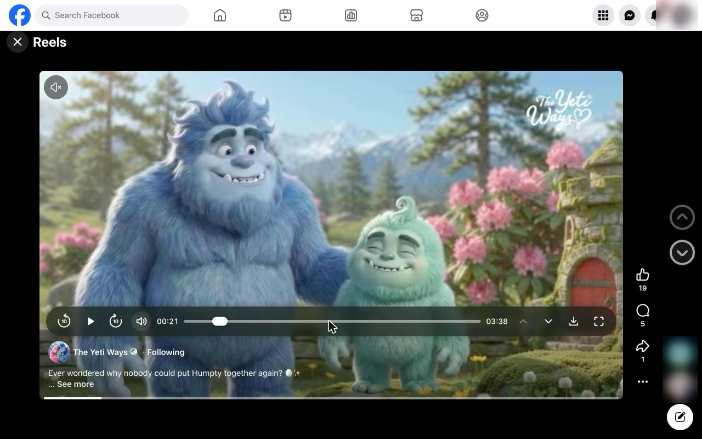
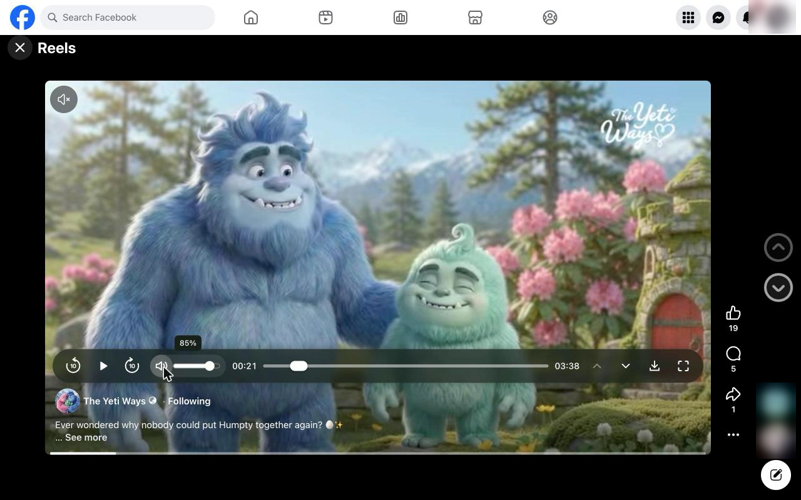
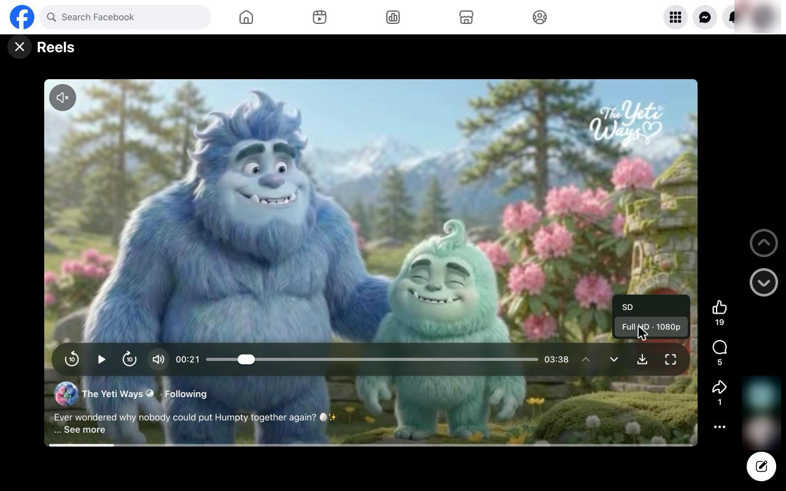
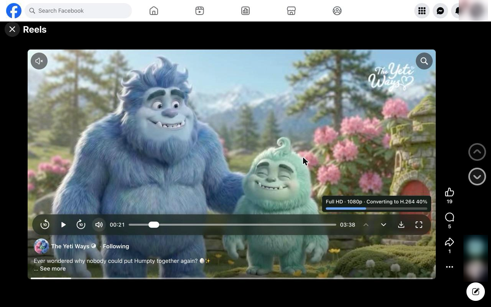

# ReelTavi – Video Controller for Facebook

A Chrome extension that gives Facebook Reels and videos a proper control bar: skip, scrub, volume, Reel navigation, fullscreen, and one-click **SD / Full HD downloads** that play everywhere.



## Features

| | |
|---|---|
| **Playback bar** | `−10s` · `▶/⏸` · `+10s` · volume · time · seek · `↑` `↓` · download · fullscreen. It sits above the page name on Reels and at the bottom of other videos. |
| **Skip and seek** | Jump 10 seconds back or forward, or drag the slider to any point. |
| **Volume** | Hover the speaker to open the slider. Click the speaker to mute or unmute. |
| **Reel navigation** | `↑` opens the previous Reel and `↓` the next. A direction that isn't available is dimmed. |
| **Fullscreen** | Use the button at the right end of the bar, or double-click a video. Auto-fullscreen for Reels can be turned on in the popup. |
| **Auto-hide** | The bar hides when the mouse leaves the video, or after 3 seconds of no movement while the video plays. |
| **Downloads** | Choose **SD** or **Full HD · 1080p**. Progress appears in the video, and the file is saved to Chrome's download folder. |



### Downloads



1. Click **Download** (beside fullscreen) and choose a quality. The labels show the real resolution, so a video whose best copy is 720p shows **HD · 720p**. If only one quality exists, it downloads right away.
2. A progress bar above the control bar shows each stage: **Downloading → Converting to H.264 → Saving to Downloads**.
3. When it finishes, choose **Show in folder**. Files are named `ReelTavi-<video id>-1080p.mp4` or `ReelTavi-<video id>-SD.mp4`.



**How it works:** Facebook serves SD as a single MP4 file, so Chrome downloads it directly. Full HD comes as separate video and audio tracks, usually encoded as VP9 or AV1. These codecs don't open in QuickTime, Finder previews or Windows Media Player. ReelTavi downloads both tracks in parallel, converts the video to H.264 with the browser's built-in encoder, and joins it with the sound. Everything happens on your computer, in a hidden extension page, so the Facebook tab stays responsive. A 3½-minute 1080p Reel takes about 45 seconds on an M-series Mac.

Downloads work for unencrypted, finished videos. Live streams and DRM-protected videos aren't supported. If a feed card has no identifiable video link, open the Reel or video on its own page and try again.

## Install

### From the Chrome Web Store

*Coming soon.*

### From source (developer mode)

1. Download or clone this repository.
2. Open `chrome://extensions` (or `edge://extensions` / `brave://extensions`).
3. Turn on **Developer mode** (top right).
4. Click **Load unpacked** and select the repository folder.
5. Open a Facebook Reel or video and move the mouse over it.

After pulling changes, click **Reload** on the ReelTavi card and refresh Facebook.

## Settings

Click the ReelTavi icon in Chrome's toolbar to:

- Show or hide the control bar
- Turn double-click fullscreen on or off
- Turn auto-fullscreen for Reels on or off

Chrome only allows fullscreen after a recent click. If a Reel starts playing on its own, the automatic request may be blocked. The bar then pulses, and one click on its fullscreen button finishes the job.

## Privacy

ReelTavi has no servers, analytics or tracking. Settings are stored in Chrome sync storage. Video files are fetched from Facebook's own servers and processed locally. See [PRIVACY.md](PRIVACY.md).

## Development

```
manifest.json         Manifest V3; runs only on facebook.com
content.js / .css     Control bar, quality menu and progress UI
popup.*               Toolbar popup and settings
download-source.js    Finds a video's SD / HD / DASH sources in Facebook's page data
download-worker.js    Service worker: starts downloads, relays progress, names files
offscreen.html/.mjs   Hidden page that builds MP4 files from separate tracks
download-mp4.mjs      Parallel track download, H.264 conversion, MP4 joining
vendor/mediabunny/    Mediabunny 1.66.2 (MPL-2.0), the MP4 reading/writing library
store/                Chrome Web Store listing text, screenshots and promo tile
scripts/package.sh    Builds the upload ZIP in dist/
```

Build the Chrome Web Store package:

```sh
./scripts/package.sh   # → dist/reeltavi-<version>.zip
```

## License

ReelTavi is released under the [MIT License](LICENSE). The bundled Mediabunny library in `vendor/mediabunny/` keeps its own [Mozilla Public License 2.0](vendor/mediabunny/LICENSE).

## Credits

MP4 processing by [Mediabunny](https://github.com/Vanilagy/mediabunny) under the [Mozilla Public License 2.0](vendor/mediabunny/LICENSE).

ReelTavi isn't affiliated with, endorsed by or sponsored by Meta Platforms, Inc. Facebook is a trademark of Meta Platforms, Inc.
